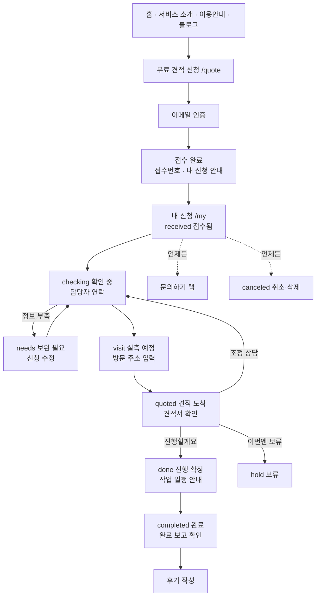

# 테두리 사이트 정리 (2026-10-16 기준)

이 문서는 지금까지 바뀐 내용, 고객 유저플로우, IA 트리를 한곳에 모은 기준표예요.
홈·서비스 소개·이용안내 문구 점검과 이용안내 목업 섹션 작업은 이 문서를 기준으로 진행해요.

---

## 1. 지금까지 바뀐 내용

### 1-1. 공개 페이지
| 페이지 | 바뀐 내용 |
| --- | --- |
| 홈 `/` | 히어로 영상·장면별 문구, 견적 신청 미리보기(대화형), 단계 안내, 마무리 CTA. 신청 완료 미리보기 안내 문구를 "신청 내역과 진행 단계는 내 신청에서 확인할 수 있어요."로 변경 |
| 서비스 소개 `/service` | 작업 구역 탐색(ZoneExplorer), 준비물·작업 종류 안내, 하단 CTA |
| 이용 안내 `/guide` | 신청 → 확인 → 실측 → 견적 흐름 안내 |
| 조경 블로그 `/blog` | 글 5편(코드에 직접 작성). `/journal` 주소는 `/blog` 로 이동 |
| 문의하기 `/contact` | 문의 유형·접수번호·내용·이메일·연락처·동의 |
| 이용약관 `/terms`, 개인정보 처리방침 `/privacy` | 운영자 정보(테두리 · 임조흔 · 010-4963-9285 · contact@tedoori.com), 시행일 2026-10-16, 보관 1년 |

### 1-2. 견적 신청 `/quote`
- 지역 → 시·군·구 → 주거 형태 → 작업 → 맡길 범위 → 사진·크기 → 희망 사항 → 시기 → 예산 → 이름·연락처 → 이메일 인증 → 확인 → 접수
- 필수 항목에 빨간 *필수 표시
- 사진은 긴 변 2000px JPEG로 줄여서 업로드

### 1-3. 내 신청 `/my` (이메일 인증 대시보드)
| 탭 | 내용 |
| --- | --- |
| 홈 | 가장 최근 신청 카드, 6단계 진행 표시, 지금 할 일, 완료 알림, 후기 요청 |
| 신청 내역 | 신청 목록(아코디언), 수정 `/my/[id]/edit`, 삭제 |
| 방문 일정 | 일정 한 장(실측 → 견적 → 작업 → 완료, D-day), 방문 주소 입력(우편번호 검색 + 동의) |
| 견적서 | 종이 견적서(항목·규격·자재비·배송비·시공비·추가 비용·부가세), 응답(진행/조정/보류 + 범위·메모), 카카오톡·문의 바로가기 |
| 완료 | 완료 보고(사진·남길 말) |
| 후기 | 별점·후기·공개 동의 |
| 문의하기 | 대시보드 안 문의 폼(접수번호·이메일·연락처 자동 입력, 수정 가능). 견적서의 '문의하기'도 이 탭으로 이동 |

- 1시간 동안 쓰지 않으면 자동 로그아웃
- 첫 화면 속도 개선: 분할 폰트, 서울 서버(icn1), 탭 카드 지연 로딩

### 1-4. 관리자 `/admin` (이메일 + 비밀번호, 고객과 별도 로그인)
- 단계 탭: 접수·확인 / 실측 / 견적 / 진행 확정 / 완료 (+ 보류·취소)
- 실측 일정·메모, 작업 일정·작업 종류(시공/배송/자재), 견적서 작성 + 미리보기
- 완료 보고 사진 업로드(자동 압축) + 미리보기
- 고객에게 보이는 문구(지금 할 일 제목·설명, 안내 메모): 기본 문구·저장 문구(저장·수정·삭제)·보이는 위치 표시

### 1-5. 메일 (Resend)
| 상태 | 고객 메일 |
| --- | --- |
| `visit` 실측 예정 | 실측 날짜 안내 |
| `needs` 보완 필요 | 보완 요청 |
| `quoted` 견적 도착 | 견적서 확인 링크 |
| `done` 진행 확정 | 확정 안내, 작업일 정해지면 작업일 안내 |
| `completed` 완료 | 완료 보고·후기 요청 |
| `hold` 보류 / `canceled` 취소 | 상태 안내 |

운영자 메일: 새 신청, 수정(전/후 비교), 삭제, 견적 응답, 후기, 주소 입력, 문의.
모든 메일에 보낸 시각을 넣어 Gmail에서 접히지 않게 함.

---

## 2. 고객 유저플로우



| 단계 | 고객이 보는 곳 | 고객이 하는 일 | 받는 메일 |
| --- | --- | --- | --- |
| 1. 알아보기 | 홈·서비스 소개·이용안내·블로그 | 서비스·과정 이해 | — |
| 2. 신청 | /quote | 질문에 답하고 사진 올리기, 이메일 인증 | — |
| 3. 접수 | 접수 완료 화면 → 내 신청 홈 | 내용 확인·수정, 방문 주소 미리 입력 | — |
| 4. 확인 | 내 신청 홈 | 담당자 연락 기다리기 / 보완 요청 시 수정 | 보완 필요 |
| 5. 실측 | 방문 일정 탭 | 방문 주소 입력, 일정 확인 | 실측 예정 |
| 6. 견적 | 견적서 탭 | 견적서 확인 → 진행/조정/보류 응답 | 견적 도착 |
| 7. 진행 | 방문 일정 탭 | 작업일 확인 | 진행 확정·작업일 |
| 8. 완료 | 완료 탭 → 후기 탭 | 완료 사진 확인, 후기 작성 | 완료 |

---

## 3. IA 트리

```
테두리 (tedoori.com)
├─ 홈 /
├─ 서비스 소개 /service
├─ 이용 안내 /guide
├─ 조경 블로그 /blog
│  └─ 글 /blog/[slug]            (/journal/* → /blog/* 이동)
├─ 무료 견적 신청 /quote
├─ 내 신청 /my                    (이메일 인증)
│  ├─ 홈
│  ├─ 신청 내역
│  │  └─ 신청 수정 /my/[id]/edit   (/my/[id] → /my?id= 로 이동)
│  ├─ 방문 일정
│  ├─ 견적서
│  ├─ 완료
│  ├─ 후기
│  └─ 문의하기
├─ 문의하기 /contact
├─ 메뉴 /menu                     (모바일 전체 메뉴)
├─ 이용약관 /terms
├─ 개인정보 처리방침 /privacy
└─ (운영자) 관리자 /admin          (검색 노출 안 함)
   ├─ 단계 탭: 접수·확인 / 실측 / 견적 / 진행 확정 / 완료 / 보류·취소
   └─ 신청 상세: 일정 · 견적서 · 완료 보고 · 고객 문구
```

### 메뉴 위치
| 위치 | 항목 |
| --- | --- |
| 상단 헤더 | 로고(홈), 서비스 소개, 이용 안내, 무료 견적 신청, 메뉴 |
| 메뉴 /menu | 홈, 서비스 소개, 이용 안내, 조경 블로그, 무료 견적 신청, 내 신청, 문의하기 / 이용약관, 개인정보 처리방침 |
| 푸터 | 서비스 소개, 이용 안내, 블로그, 견적 신청, 문의하기, 이용약관, 개인정보 처리방침, 카카오톡 채널 |

### IA에서 확인할 점
- 헤더에 **내 신청** 바로가기가 없어요(메뉴 안에만 있음). 신청한 고객이 다시 들어오는 길이 메일 링크와 메뉴뿐이에요.
- 푸터에도 **내 신청**이 없어요.
- `/design`(디자인 시스템 확인용)과 `app/_lab-*`(예전 실험)은 고객 메뉴에 없음. 정리 여부는 다음에 결정.
- 블로그는 아직 코드에 직접 쓴 글이라, 관리자 편집기를 만들면 `/admin` 아래에 **블로그** 메뉴가 생겨요.

---

## 4. 다음 단계
1. ✅ 신청 완료 안내 문구 수정 (문자 안내 삭제)
2. ✅ 이 문서 (바뀐 내용 · 유저플로우 · IA)
3. 홈 · 서비스 소개 · 이용안내 문구 점검 → 수정 목록 승인 → 수정
4. 이용안내에 내 신청 목업 섹션 추가
5. 블로그 디자인 · 상단 흰 선 수정
6. 관리자 블로그 편집기 (이미지 · 글꼴 · 크기 · 정렬)
